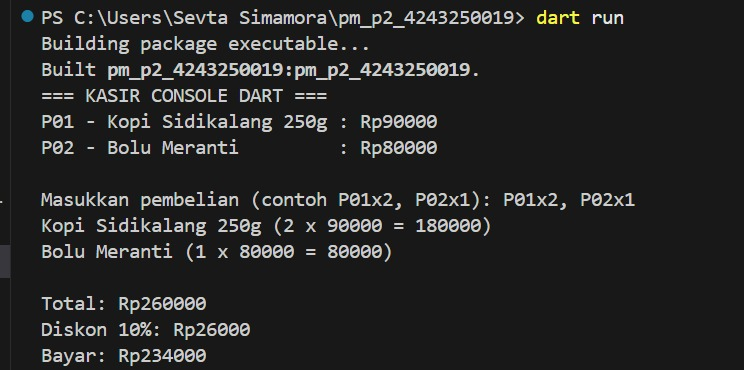
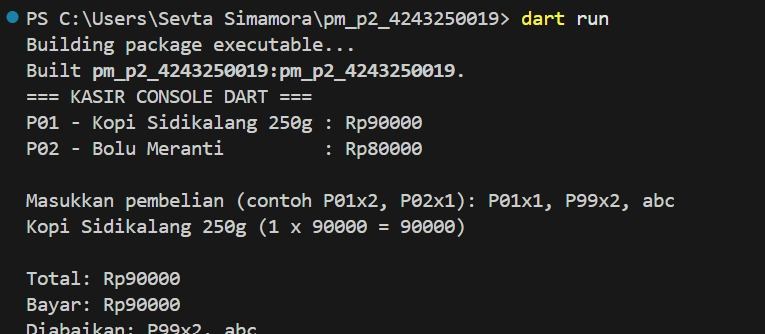

# TUGAS RUTIN 2 – KASIR CONSOLE DART

## 1. Identitas Mahasiswa

- **Nama:** Sevta Simamora
- **NIM:** 4243250019
- **Kelas:** PSIK 24C
- **Mata Kuliah:** Pemrograman Mobile
- **Tugas:** Tugas Rutin 2

## 2. Deskripsi Program

Program Kasir Console Dart merupakan aplikasi sederhana berbasis terminal yang dibuat menggunakan bahasa pemrograman Dart. Program ini digunakan untuk melakukan simulasi transaksi pembelian barang berdasarkan kode produk dan jumlah pembelian.

Program dapat menghitung subtotal barang, total transaksi, diskon, dan jumlah pembayaran akhir. Program juga menerapkan penanganan input yang tidak valid agar proses transaksi dapat berjalan dengan baik.

## 3. Teknologi yang Digunakan

- Bahasa pemrograman: Dart
- Dart SDK: 3.13.5
- Editor: Visual Studio Code
- Sistem operasi: Windows

## 4. Konsep Pemrograman Dart yang Digunakan

### Penggunaan Variabel

- `var`: Menyimpan variabel yang nilainya dapat berubah.
- `final`: Menyimpan nilai yang hanya ditetapkan satu kali.
- `const`: Menyimpan nilai konstan yang telah diketahui sejak awal program.

### Penerapan Null Safety

- `stdin.readLineSync() ?? ''` digunakan untuk menangani kemungkinan input bernilai null.
- `int.tryParse()` digunakan untuk mengonversi input menjadi angka secara aman.
- `if (produk != null)` digunakan untuk memeriksa keberadaan produk sebelum mengakses datanya.

## 5. Cara Menjalankan Program

1. Buka folder proyek melalui Visual Studio Code.
2. Buka Terminal dengan memilih **Terminal → New Terminal**.
3. Jalankan perintah:

```bash
dart pub get
```

4. Jalankan program menggunakan perintah:

```bash
dart run
```

5. Masukkan data pembelian sesuai format yang diminta program.

## 6. Dokumentasi Input dan Output

### Pengujian 1 – Input Valid dan Mendapatkan Diskon

Input:
```text
P01x2, P02x1
```

Output:
```text
Kopi Sidikalang 250g (2 x 90000 = 180000)
Bolu Meranti (1 x 80000 = 80000)
Total: Rp260000
Diskon 10%: Rp2600
Bayar: Rp234000
```

**Dokumentasi:**




### Pengujian 2 – Input Kode Produk Tidak Valid

Input:
```text
P01x1, P99x2, abc
```

Output:
```text
Kopi Sidikalang 250g (1 x 90000 = 90000)
Bayar: Rp90000
Diabaikan: P99x2, abc
```

**Dokumentasi:**




## 7. Kesimpulan

Berdasarkan pengerjaan tugas ini, saya mempelajari penerapan dasar bahasa pemrograman Dart melalui pembuatan program kasir berbasis console. Program ini menerapkan penggunaan variabel, null safety, percabangan, perulangan, dan pengolahan input pengguna.

Melalui program ini, saya juga memahami cara melakukan perhitungan transaksi, menghitung diskon, serta menangani input yang tidak sesuai dengan format yang ditentukan.

## 8. Pernyataan Penggunaan AI

AI digunakan sebagai alat bantu untuk memahami konsep pemrograman Dart, mempelajari penggunaan variabel dan null safety, serta membantu penyusunan dokumentasi. Kode diperiksa dan diuji kembali selama proses pengerjaan. Penggunaan AI disesuaikan dengan ketentuan tugas dan proses pengerjaan yang sebenarnya.